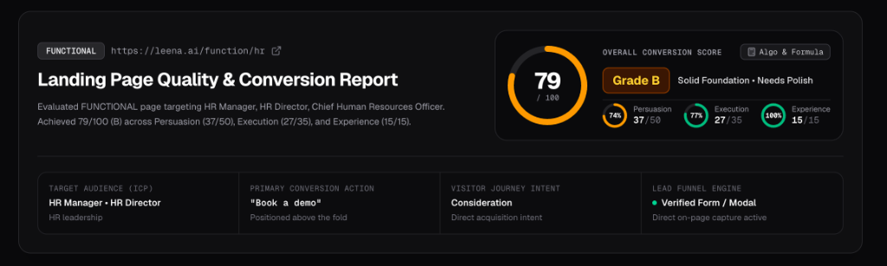
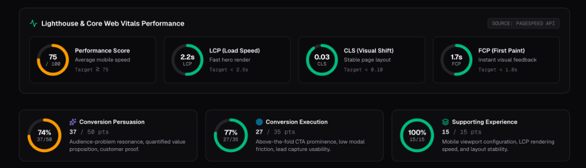
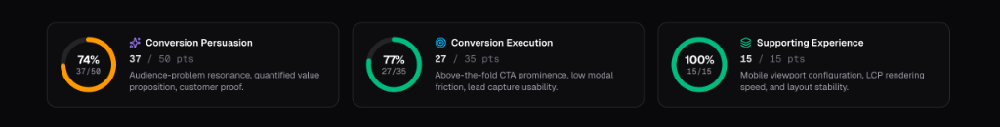
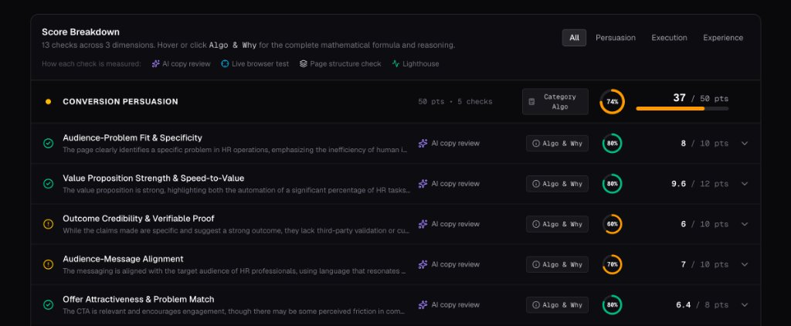

# Convex — Audience-Aware Landing Page Conversion Grader

Convex is an evidence-based Conversion Rate Optimization (CRO) grader that evaluates any landing page across **Conversion Persuasion**, **Conversion Execution**, and **Supporting Experience**. It combines deterministic DOM extraction, AI semantic copy analysis, live headless browser verification, and interactive full-page screenshot hotspot pinning.

---

## Visual Walkthrough & Product Interface

### 1. Executive Score Hero & Minimal Audience Context Strip

- **Overall Conversion Score Pod**: Displays the final `0–100` score (`79 / 100`), letter grade (`Grade B`), mini dimension gauges (`Persuasion 37/50`, `Execution 27/35`, `Experience 15/15`), and the **`Algo & Formula`** popover trigger showing the master Rubric v3 equation.
- **Minimal 4-Column Context Strip**: Summarizes the classified **Target Audience (ICP)** (`HR Manager • HR Director`), **Primary Conversion Action** (`"Book a demo"` above the fold), **Visitor Journey Intent** (`Consideration`), and **Lead Funnel Engine** (`Verified Form / Modal`).

---

### 2. Full-Page Visual Audit Studio & Section Hotspot Pins

- **Dynamic Full-Page Canvas (Left)**: Renders the live Playwright full-page capture and overlays numbered, color-coded pins (`#1` green strength, `#2` amber warning, `#3` red high-priority issue) anchored to actual DOM section coordinates (`0%–100% Y`). Hovering or clicking any pin opens an edge-aware diagnostic card on the canvas.
- **Actionable CRO Fix Cards (Right)**: Lists prioritized issues paired with the exact page zone (`Hero CTA Area ~14%`, `Social Proof Band ~26%`), concrete **Direct Fix** copy/engineering instructions, expected conversion lift, and a **`Locate Pin`** button that auto-scrolls the screenshot canvas to that element.

---

### 3. Lighthouse Core Web Vitals & Dimension Summary

- **Core Web Vitals Gauges**: Evaluates mobile **Performance Score** (`75 / 100`), **LCP (Load Speed)** (`2.2s` vs. `< 2.5s` target), **CLS (Visual Shift)** (`0.03` vs. `< 0.10` target), and **FCP (First Paint)** (`1.7s` vs. `< 1.8s` target) using uniform circular SVG rings.

---

### 4. Three-Pillar Rubric v3 Dimension Cards

- Breaks the `100`-point rubric into its three weighted pillars:
  1. **Conversion Persuasion (`50 pts max`)**: Audience-problem resonance, quantified value proposition, and verifiable customer proof.
  2. **Conversion Execution (`35 pts max`)**: Above-the-fold CTA prominence, promise-destination consistency, live lead-capture verification, and form friction.
  3. **Supporting Experience (`15 pts max`)**: Mobile viewport configuration, LCP rendering speed, layout stability, and readability.

---

### 5. Aligned Score Breakdown & Interactive `Algo & Why` Popovers

- **Pixel-Aligned 7-Column Grid**: Category headers (`CONVERSION PERSUASION — 37 / 50 pts`) and individual criterion rows share the exact same grid columns for status icons, measurement source tags (`AI copy review`, `Live browser test`, `Page structure check`, `Lighthouse`), **`Category Algo` / `Algo & Why`** triggers, circular percentage rings, and point totals.
- **Transparent Math & Evidence**: Clicking or hovering **`Algo & Why`** reveals the exact mathematical formula, live point substitution, evaluated sub-check pass/fail inputs, and verbatim evidence extracted from the page.

---

## Core Architecture & 6-Stage Pipeline

When a URL is submitted (`POST /api/grade`), Convex streams real-time server milestones (`application/x-ndjson`) across 6 stages:

1. **Supabase URL Cache Check**: Queries `public.landing_page_audits` by normalized URL. Previously audited pages load instantaneously without re-fetching unless a live re-run (`forceRefresh: true`) is requested.
2. **Safe DOM & Signal Extraction**: SSRF-guarded HTML fetch + Cheerio parsing for headings (`H1`–`H3`), CTAs, form fields, trust badges, customer quotes, and metadata.
3. **Audience & Intent Classification**: Classifies `pageType` (`homepage`, `product`, `functional`, `campaign`, `resource`, `case_study`), target ICP roles, and `visitorIntent` (`discovery`, `consideration`, `high_intent`, `education`).
4. **Semantic Persuasion Evaluation**: Evaluates copy specificity, quantified outcomes, speed-to-value, third-party credibility, and offer friction on a structured `0–10` scale (with deterministic heuristic fallback).
5. **Live Playwright Browser Verification**: Renders the page in headless Chromium, captures a full-page screenshot, discovers actual DOM section coordinates (`0%–100% Y`), clicks the primary CTA, and verifies whether an interactive lead-capture form or modal renders.
6. **Rubric v3 Scoring & Pin Mapping**: Computes the deterministic `0–100` score, applies Conversion-Readiness Gates, and maps evidence-backed issues and strengths onto the screenshot canvas.

---

## Rubric v3 Scoring Algorithm (`100 Points Max`)

> **Master Formula:**  
> $$\text{Total Score} = \operatorname{round}\!\Big(\text{Persuasion}_{/50} + \min(\text{Execution}_{/35},\, \text{GateCap}) + \text{Experience}_{/15}\Big)$$

LLMs never directly output the final score—deterministic TypeScript rules scale and gate all inputs.

### Dimension A: Conversion Persuasion (`50 pts`)
Each check is rated `0–10` against strict evidence criteria and scaled via $\operatorname{round}((\text{Rating}/10) \times \text{MaxPts}, 1)$:
| Check | Max Pts | What It Measures |
| :--- | :---: | :--- |
| **1. Audience-Problem Fit & Specificity** | `10` | Concrete buyer pain point articulated in hero/headings vs. generic fluff |
| **2. Value Proposition & Speed-to-Value** | `12` | Clear H1 outcome + quantified impact (`%`, `$`, `x`) + time-to-value |
| **3. Outcome Credibility & Verifiable Proof** | `10` | Customer-attributed case studies & metrics vs. unverified logo walls |
| **4. Audience-Message Alignment** | `10` | Role-specific workflow terminology aligned with the classified ICP |
| **5. Offer Attractiveness & Problem Match** | `8` | Relevance of the primary CTA offer to the problem & perceived friction |

### Dimension B: Conversion Execution (`35 pts`)
Evaluated via DOM rules + live Playwright click verification:
| Check | Max Pts | Scoring Formula |
| :--- | :---: | :--- |
| **6. CTA Prominence & Next-Step Clarity** | `10` | Above-the-fold (`+5`) + Action verb (`+3`) + Next-step microcopy (`+2`) |
| **7. Promise-Destination Consistency** | `8` | CTA action & modal/destination match headline promise (`7–8` pass, `3–4` gated mismatch, `0` missing) |
| **8. Lead Capture Usability & Verification** | `10` | Playwright live form verified (`10`) \| Static `<form>` inputs (`8`) \| Unverified script only (`3.5–4`) \| None (`0`) |
| **9. Conversion Friction & Simplicity** | `7` | `≤ 4` fields (`7`) \| `5–7` fields (`4.5`) \| `> 7` fields (`2`) |

#### Conversion-Readiness Gates (Applied to Dimension B)
High persuasive copy cannot convert if the capture mechanism is broken:
- **Missing Primary CTA Gate**: If no primary CTA exists, Execution is capped at **20%** (`7.0 / 35 pts`).
- **Missing / Unverified Lead Capture Gate**: If the page objective requires lead generation (`demo`, `trial`, `register`, `contact`) and no working form is detected, Execution is capped at **30%** (`10.5 / 35 pts`).

### Dimension C: Supporting Experience (`15 pts`)
| Check | Max Pts | Threshold Tiers |
| :--- | :---: | :--- |
| **10. Largest Contentful Paint (LCP)** | `5` | `≤ 2.5s` (`5`) \| `≤ 4.0s` (`2.5`) \| `> 4.0s` (`0`) |
| **11. Cumulative Layout Shift (CLS)** | `4` | `≤ 0.10` (`4`) \| `≤ 0.25` (`2`) \| `> 0.25` (`0`) |
| **12. Mobile Viewport Configuration** | `3` | `meta[name="viewport"]` present (`3`) \| absent (`0`) |
| **13. Text Readability & Structure** | `3` | Clear H1 + `≥ 100` words (`3`) \| H1 only (`1.5`) \| missing (`0`) |

**Letter Grades:** `A` (`≥ 85`) • `B` (`70–84`) • `C` (`55–69`) • `D` (`40–54`) • `F` (`< 40`)

---

## Supabase Caching, Audit History & Report Exports

- **Instant URL Cache (`public.landing_page_audits`)**: Stores every evaluation keyed by normalized URL so repeat visits load immediately without re-running Playwright or LLM calls.
- **Historical Audit Timeline**: Browse all saved website evaluations from the homepage or top **History** drawer, or click **Re-run Live Audit** to capture a fresh snapshot.
- **1-Click Exports**: Export any audit report and its prioritized recommendations as **Markdown (`.md`)**, **Recommendations CSV (`.csv`)**, or **Structured JSON (`.json`)**.

---

## Quick Start

```bash
# 1. Install dependencies
pnpm install

# 2. Configure environment variables (.env.local)
NEXT_PUBLIC_SUPABASE_URL=https://<your-project-ref>.supabase.co
NEXT_PUBLIC_SUPABASE_PUBLISHABLE_KEY=sb_publishable_...
OPENAI_API_KEY=sk-...          # Optional: falls back to deterministic evaluator if omitted
PAGESPEED_API_KEY=...          # Optional: falls back to synthetic Web Vitals if omitted

# 3. Start development server
pnpm dev

# 4. Run test suite (56 unit & scenario tests)
pnpm vitest run
```
