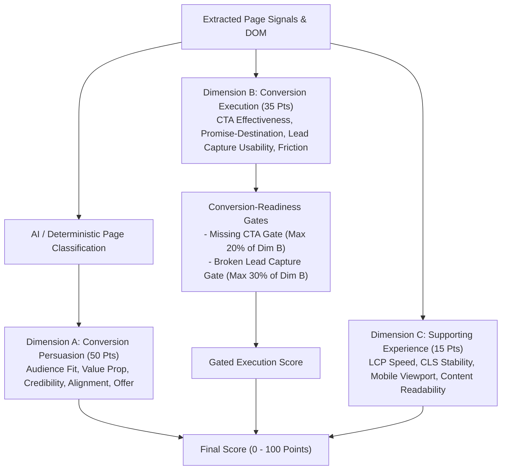

# Convex Landing Page Evaluation Engine: Phase 3 Final Methodology

## 1. Executive Summary & Evaluation Philosophy

Landing page optimization often falls into the trap of checklist verification—counting whether an H1 tag exists, whether a logo carousel is rendered, or whether a tracking snippet is present in the DOM. Such systems inevitably suffer from **score inflation**: broken or misleading pages achieve 90+ scores merely by satisfying superficial criteria.

**Rubric v3** replaces the checklist paradigm with a fundamental CRO question:

> *"Given a visitor who matches the page's intended audience and arrives with relevant intent, how effectively does this page persuade them to complete its primary conversion action?"*

To answer this question, Rubric v3 separates landing page evaluation into three orthogonal, non-leaking dimensions:

---

## 2. Dimension Breakdown & Scoring Architecture

The maximum total score is **100 points**, allocated across three dimensions:

| Dimension | Max Points | Evaluation Mechanism | Key Role |
|---|---:|---|---|
| **Dimension A: Conversion Persuasion** | 50 | OpenAI semantic evaluator (with deterministic fallback) | Persuasive clarity, role alignment, credibility of proof |
| **Dimension B: Conversion Execution** | 35 | Playwright dynamic interaction verification & DOM inspection | Actionability, functional lead capture, promise fulfillment |
| **Dimension C: Supporting Experience** | 15 | PageSpeed Core Web Vitals & document structure | Technical delivery, visual stability, reading UX |

---

### Dimension A: Conversion Persuasion (50 Points Max)

Dimension A is scored on a **continuous, graded scale (0–10 points each)** evaluated semantically by `gpt-5-mini` (or `gpt-4o-mini` fallback), mapped to rubric point weights:

#### A1. Audience–Problem Fit & Specificity (10 Points)
- **Scoring rule**:
  - `High Specificity (8–10 pts)`: Page identifies an acute, role-specific operational pain point with concrete operational terms.
  - `Moderate Specificity (5–7 pts)`: Problem is clearly implied, but framed broadly.
  - `Vague/Generic (2–4 pts)`: Problem is generic (e.g. "work smarter", "save time").
  - `None (0–1 pt)`: No problem identified or page lacks audience focus.
- **Evidence constraint**: Must cite verbatim quotes from headings, meta descriptions, or hero copy.

#### A2. Value Proposition Strength & Speed-to-Value (12 Points)
- **Scoring rule**:
  - `Exceptional (10–12 pts)`: Clear, quantifiable outcome combined with explicit speed-to-value (e.g. "live in 45 days", "70%+ tickets auto-resolved").
  - `Strong (7–9 pts)`: Clear concrete outcome, but lacking timeframe or quantifiable metric.
  - `Moderate (4–6 pts)`: Understandable product capability without clear differentiation or customer impact.
  - `Weak/Buzzword (0–3 pts)`: Vague promises ("all-in-one AI platform").

#### A3. Outcome Credibility & Verifiable Proof (10 Points)
- **Scoring rule**:
  - `Verified Customer Evidence (8–10 pts)`: Customer-attributed case metrics, named logo proof, and third-party validation.
  - `Company Claims with Specifics (5–7 pts)`: Specific metric claims made directly by vendor without customer attribution.
  - `Logo Wall Only (3–4 pts)`: Unattributed customer logos without metric outcomes.
  - `Unsubstantiated (0–2 pts)`: Unsupported superlatives ("industry leading").

#### A4. Audience–Message Alignment (10 Points)
- **Scoring rule**:
  - Evaluates whether the language, terminology, and integration logos match the target role (e.g., HR executive vs CIO vs developer).
  - Penalizes role misalignment or jarring tone mismatch.

#### A5. Offer Attractiveness & CTA Problem Match (8 Points)
- **Scoring rule**:
  - Evaluates whether the primary call to action directly answers the acute problem identified on the page with minimal cognitive friction.

---

### Dimension B: Conversion Execution (35 Points Max)

Dimension B evaluates whether a convinced visitor can actually convert:

#### B1. CTA Prominence & Next-Step Clarity (10 Points)
- Above-the-fold presence (+5 pts)
- Action-oriented copy (+3 pts)
- Clarity of next step / low competing CTA clutter (+2 pts)
- Missing CTA = 0 pts

#### B2. Promise–Destination Consistency (8 Points)
- Evaluates whether clicking the CTA delivers on its promise.
- *Webinar / Educational example*: If a button reads *"Watch now"* but opens an aggressive sales demo gate requiring phone numbers, points are docked (awarded 3–4 pts max) for cognitive dissonance.

#### B3. Lead Capture Usability & Live Verification (10 Points)
- **The Core Script Presence Fix**: In previous rubrics, detecting `hs-scripts.com` awarded full lead capture points (11/11).
- **In Rubric v3**:
  - **Live Playwright Verified Form**: Form renders interactively and accepts input on CTA click = **10/10 pts**.
  - **Explicit Inline Form Inputs in DOM**: Verified email input in DOM = **8/10 pts**.
  - **Script Tag Only (Unverified)**: Script tag present without interactive verification = **3.5/10 pts max**.
  - **Missing / Broken Form**: 0 pts.

#### B4. Conversion Friction & Funnel Simplicity (7 Points)
- Field count $\le 4$ fields: **7 pts** (optimal low friction).
- Field count 5–7 fields: **4.5 pts** (moderate friction).
- Field count $> 7$ fields: **2 pts** (high friction drop-off risk).

---

### Dimension C: Supporting Experience (15 Points Max)

Technical foundation based on Core Web Vitals:
1. **Largest Contentful Paint (LCP)** (5 pts): $\le 2.5\text{s} \to 5$, $\le 4.0\text{s} \to 2.5$, $> 4.0\text{s} \to 0$.
2. **Cumulative Layout Shift (CLS)** (4 pts): $\le 0.10 \to 4$, $\le 0.25 \to 2$, $> 0.25 \to 0$.
3. **Mobile Viewport Meta Configuration** (3 pts): Present $\to 3$, Absent $\to 0$.
4. **Text Readability & Structure** (3 pts): Clear H1 + word count $\ge 100$ words $\to 3$ pts.

---

## 3. Conversion-Readiness Gates

A major flaw of additive rubrics is that high design or copy scores can mask a broken conversion path. Rubric v3 implements two strict conversion gates applied strictly to Dimension B:

1. **Missing Primary CTA Gate**:
   - If a page has NO call-to-action, Dimension B is capped at **20% of its maximum** (max 7/35 points earned).
2. **Broken / Absent Lead Capture Gate**:
   - If lead generation is required for the conversion objective and the form fails or is absent, Dimension B is capped at **30% of its maximum** (max 10.5/35 points earned).

> [!IMPORTANT]
> **Clean Dimension Separation**: Gates do NOT penalize Dimension A (persuasion). A page with exceptional copywriting and a broken button maintains a high Persuasion score (e.g. 45/50) while its Execution score collapses (7/35), giving CRO practitioners exact diagnostic visibility into where the funnel broke.

---

## 4. Elimination of Score Inflation & Double Normalization

In Rubric v2, when a criterion was declared `not_applicable`, two things happened simultaneously:
1. Its points were deducted from the denominator (scaling up remaining points).
2. Its weight was shifted to another criterion (e.g., compliance 6 pts shifted to case study).

This resulted in artificial double-normalization, allowing resource/webinar pages to score 93+ despite weak conversion paths.

**Rubric v3 Rule**:
- Weights are fixed.
- No weight shifting between criteria.
- Denominator is fixed at 100 points.
- If a criterion is not applicable to a specific page format, it receives a neutral partial score based on contextual expectations rather than artificially inflating the denominator.

---

## 5. Tier C Traffic-Adjusted Benchmark: Simulated Status

The Tier C benchmark compares actual conversion rate ($CVR_{\text{actual}}$) against traffic-intent expected conversion rate ($CVR_{\text{expected}}$) based on channel mix:

$$CVR_{\text{expected}} = \sum (\text{Channel Share} \times \text{Channel Baseline CVR})$$

$$\text{Traffic Efficiency} = \frac{CVR_{\text{actual}}}{CVR_{\text{expected}}}$$

> [!WARNING]
> **Simulated Status Declaration**: Leena AI provided aggregate page sessions and form fills, but **channel-level conversion breakdowns were not empirically captured** in the dataset. Therefore, Tier C metrics are explicitly documented as **simulated traffic-intent projections** using B2B industry baselines (Paid Search = 1.5%, Direct = 1.0%, Paid Social = 0.15%), NOT empirical channel observations.
